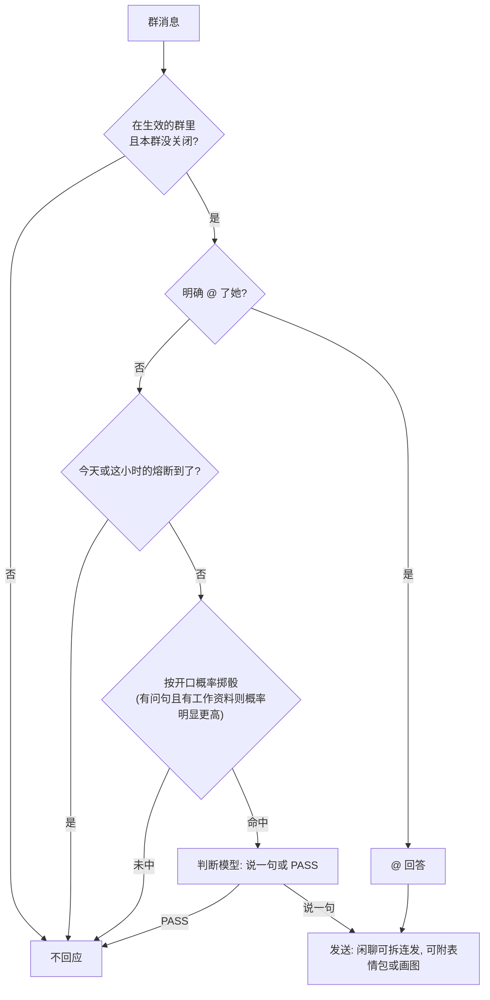

<div align="center">

# innerlife

让 QQ 群里的 AstrBot 机器人像一个有脾气、有记性、有自己生活的群友

[](metadata.yaml)
[](https://github.com/AstrBotDevs/AstrBot)
[](#限制)
[](LICENSE)
[](https://cloud.astrbot.app/plugin/DawnJson/astrbot_plugin_innerlife)

[功能](#功能) · [安装](#安装) · [配置](#配置) · [画图](#画图) · [数据和隐私](#数据和隐私) · [限制](#限制) · [常见问题](#常见问题) · [写功能插件](#写功能插件)

</div>

装上之后，她不再是"@ 一下回一句"的问答机：没人叫她时，她会看气氛自己决定插不插话、要不要开个新话题；她有当下的心情，对每个人有不同的好感，记得群友提过的事，每天写日记、排日程、看天气和新闻。话多了会累，被冲撞会炸毛，聊开了会连着发几条，看到喜欢的表情包会收藏起来，之后自己发出去。

innerlife 是一个拟人化框架，只管"她是谁、怎么说话、现在什么状态"，不含任何具体业务。知识库答疑、状态卡片、群管这类功能写成独立的功能插件，按 [`docs/design.md`](docs/design.md) 的钩子约定和它配合，见[写功能插件](#写功能插件)。

## 功能

- **说话量**：没被 @ 时不靠每日次数硬限，而是由状态算一个开口概率（被叫到名字、被回复、有人提问、问到有工作资料的事、好感、心情、兴致、热度都会抬高它，睡着时压低），代码先掷骰子，命中才付费调用判断模型，模型仍可 PASS。她主动说的话占群里发言的比例会慢慢逼近 `talk.share`，回答 @ 不算在内；想开新话题的冲动在群冷着时一路攒，开过话题后回落。公式和旋钮见 [design.md · 说话量](docs/design.md#说话量talkpy-mainpy)。
- **插话判断**：每批没 @ 她的群消息先过开口概率，命中后由模型按心情和兴致决定闲聊一句还是不说话，只回最新的几条，10 分钟前的话不回。有人问到她工作范围内的事（某个功能插件给出了相关工作资料）时，开口概率明显升高但仍要掷骰；命中后提示词要求：真的工作问题没人答好就一定答，心情只影响语气，只是字面沾边的闲聊可以 PASS。@ 她时同一时刻别人问的工作问题会一并答；同一个人连着 @ 她很多次时她可以简短回、只发表情包或不理。
- **情绪四层**：具体情绪（会衰减）→ 背景心情 → 兴致（全群共用一个）→ 对每个人的好感。性格参数可调，默认易炸毛、不记仇、一示好就软。
- **记忆**：从对话里记下群友的小事，再次提起会加深，久了会忘；私密的事不进提示词。每天深夜整理一次，当天的聊天记录整段都读（太长就分段）。
- **日记**：每天 8 节固定模板，外加周记、月记；最近几天的日记会影响她当天的状态。
- **生活**：每天醒来给自己排日程（最后一行定当晚几点睡，睡 7 小时），看所在城市的天气、节假日和新闻；群里安静时可能自己开个话头，睡着时不开，也很少插话。
- **连发**：闲聊时按打字速度拆成几条发出（条数随兴致和激动程度变，最多 4 条）；答疑和多步说明始终一条。
- **识图和表情包**：看群里的图片和表情包；遇到真心喜欢的反应图会收藏，之后在合适的时候自己发出去，也可以只发一张表情。只收 png/jpg/gif/webp，真人照片、带个人信息的截图、敏感内容不收；存的时候最长边缩到 120 像素，动图保留动画。
- **画图**：接上能返回图片的 MCP 服务后，她可以在回复里自己决定画一张，经过屏蔽词和每日张数检查，见[画图](#画图)。
- **安全底线**：高危请求拒绝、密钥脱敏、链接白名单、提示词注入防护、冷却、并发和排队、`/机器人 开启/关闭` 开关。她不把任何工具交给模型：模型请求里的工具一律清空。
- **成本熔断**：每个群每天后台聊天调用到 `basic.daily_call_fuse`（默认 300 次）、或一小时内到 50 次就停，只回复 @；`0` 表示一直只回复 @。

一条群消息的大致走向（细节见 [design.md · 说话量](docs/design.md#说话量talkpy-mainpy)）：



## 安装

### 环境要求

- AstrBot `>=4.26.7,<5`
- 平台：`aiocqhttp`（OneBot v11，如 NapCat），只支持 QQ 群
- 一个聊天模型。可选：一个后台模型（插话判断、整理、日记、日程等，`basic.background_provider_id`），一个能返回图片的 MCP 服务
- 后台任务需要访问外网：天气 [open-meteo](https://open-meteo.com/)、节假日 [holiday-cn](https://github.com/NateScarlet/holiday-cn)、新闻 RSS（默认是几个中文科技、游戏和影评站，可改 `life.news_feeds`）

没有额外的 Python 依赖（`httpx`、`mcp`、`Pillow` 随 AstrBot 安装）。

### 插件市场

在 AstrBot WebUI 的插件市场搜索 `innerlife` 安装，或打开[市场页面](https://cloud.astrbot.app/plugin/DawnJson/astrbot_plugin_innerlife)。

市场不会跟着 GitHub 自动更新：市场里的版本停在作者上次重新发布的那次提交，可能落后于 GitHub。想要最新版本，用下面的 Git 方式。

### Git

```sh
cd AstrBot/data/plugins
git clone https://github.com/DawnJson/astrbot_plugin_innerlife.git
```

更新时在插件目录里 `git pull`。装好或更新后重启 AstrBot。

## 配置

所有设置都在 WebUI 的插件配置里改。默认值只在 [`_conf_schema.json`](_conf_schema.json) 里写一份。

### 最少要改的几项

| 键 | 说明 |
|---|---|
| `basic.persona_prompt` | 她的人设和说话方式。安全底线由程序固定在它前面，人设改不掉 |
| `basic.work_background` | 她的工作：身份和边界，留空表示没有；填了之后系统提示词里紧跟人设有一节「你的工作」 |
| `basic.bot_names` | 群友对她的称呼，用来判断是不是在叫她 |
| `basic.group_ids` | 生效的群号；空表示所有群 |
| `basic.allowed_link_domains` | 回复里允许出现的 HTTPS 域名（含子域名）；空表示不发任何链接。不带 `://` 的 `settings.json`、`config.yaml` 这类文件名（后缀不是真实顶级域名）不算链接 |
| `basic.error_reply_prefixes` | 当作出错的回复开头，默认空，见[常见问题](#常见问题) |
| `life.city_name` / `life.latitude` / `life.longitude` / `basic.timezone` | 她"住"的城市和时区，用于天气和作息；默认上海、`Asia/Shanghai` |
| `basic.background_provider_id` | 后台调用用的模型提供商；留空用聊天模型 |

### 全部分组

66 个配置项，在 WebUI 里分成 10 组：

| 组 | 内容 |
|---|---|
| `basic` 基础与安全 | 生效的群、人设、称呼、链接白名单、脱敏、开关命令、冷却和并发、后台模型、每日调用熔断、识图、搜索规则、时区 |
| `messages` 提示语 | 拒绝、图片超限、冷却、排队、出错等群里会看到的话 |
| `emotion` 情绪 | 开关、易炸毛、记仇、心软、心情半衰期和基线、好感淡化 |
| `memory` 记忆与日记 | 记忆开关和半衰期、「忘掉我」命令、按天删除、整理时间、日记开关和保留天数 |
| `life` 生活 | 日程、天气、新闻开关，新闻源和屏蔽词，节假日数据，城市和经纬度 |
| `proactive` 主动 | 主动开话题的开关、群里安静多久才考虑开话题 |
| `talk` 说话量 | 她占群里发言的目标比例、随机程度、兴致恢复快慢、想开新话题的冲动攒多快、聊开后接着说的倾向、随口一句比群友长几倍 |
| `draw` 画图 | 开关、工具名、固定参数、每日张数、屏蔽词 |
| `burst` 连发 | 开关 |
| `sticker` 表情包 | 开关、最多收藏几张、单张大小上限 |

功能开关是各组里的 `enabled`（记忆组的日记是 `diary`，生活组是 `schedule` `weather` `news`）。`talk` 组每个旋钮的含义和默认值见 [design.md · 旋钮](docs/design.md#旋钮talk-分组)。

启动时插件会创建（或更新）一个 AstrBot 人格 `basic.astrbot_persona_id`（默认 `innerlife`）。它只用来在模型调用报错时给群里一句统一的出错提示（文字取自 `messages.model_error_message`）；她平时的人设和系统提示词每次请求都由插件现拼，不读这个人格。要让出错提示生效，把它设成 AstrBot 的默认人格。

## 画图

画图用的是一个已经在 AstrBot 里注册好的工具，框架不绑定具体的服务：

1. 在 AstrBot 里添加一个能生成图片的 MCP 服务。AstrBot 只允许 `node`、`npx`、`python`、`uvx` 等启动器，不允许 `sh`/`bash`。参考实现：[ZZK-Image-Mcp](https://github.com/DawnJson/ZZK-Image-Mcp)（npm 包 `zzk-image-mcp`）。
2. 框架从工具的返回里取图，两种都认：
   - MCP 标准的图片内容（`ImageContent`）：框架解码后写进 `data/plugin_data/astrbot_plugin_innerlife/images/`；
   - 返回文字里出现的图片文件路径（绝对路径，后缀 png/jpg/jpeg/webp/gif，不要求特定前缀，如 `saved: <路径> (…)`）：只收 `images/` 目录里存在的文件，目录外的路径一律忽略。让服务把图片存到这个目录。

   返回里既有 `ImageContent` 又有路径时只取 `ImageContent`，避免同一张图发两遍。
3. 配置 `draw.enabled: true`（默认关）、`draw.draw_tool_name`（AstrBot 里的工具名，默认 `image_generate`）、`draw.draw_tool_arguments`（固定参数）和 `draw.draw_daily_limit`（默认每天 5 张）。AstrBot 的插件配置没有自由字典类型，`draw.draw_tool_arguments` 填 JSON 文本，例如 `{"quality": "low"}`。

她在回复里决定要画时，回复发出后由框架调用工具，图片发出后删除文件；调用失败只记日志、不发图。参数里的文字命中屏蔽词（程序内置的未成年、露骨、血腥、违法、极端主义词表，加上 `draw.draw_blocked_terms`，默认是政治人物）或当天张数用完时不会调用。

## 数据和隐私

插件会在 `data/plugin_data/astrbot_plugin_innerlife/` 下保存群友的数据，**部署前请告知群成员**。所有状态都在一个 SQLite 文件 `innerlife.db` 里：

| 内容 | 表 | 保留多久 |
|---|---|---|
| 对每个群友的昵称、好感、一句话印象 | `people` | 一直保留；可用 `memory.person_keep_days`（默认 180 天）让长期不说话的人自动删除 |
| 群友说过的事（记忆） | `memories` | 按遗忘曲线衰减，弱到阈值以下删除 |
| 当天的群聊原文 | `chat_log` | 每晚整理完清空 |
| 日记、周记、月记 | `diaries` | `memory.diary_keep_daily_days`（默认 30 天）/ `memory.diary_keep_weekly_days`（默认 180 天），月记永久 |
| 情绪、心情（含兴致）、日程、天气、新闻 | `emotions` `mood` `life` `news` | 情绪 3 天，新闻 7 天 |
| 每个群的说话状态、后台聊天调用的熔断计数 | `talk` `model_calls` | 说话状态一直保留；熔断计数只留当天 |
| 说话决策日志（每次判断和开话题的概率、特征、结果，用来调参） | `talk_log` | 14 天 |
| 她收藏的表情包（说明、用了几次）和图片文件 `stickers/<sha256>.<ext>` | `stickers` | 最多 `sticker.max_count` 张（默认 200），超出删用得最少、收藏最早的；管理员可随时删 |
| 夜间任务进度、画图次数、各群回复开关 | `night_jobs` `tool_usage` `disabled_groups` | 夜间进度和用量只留最近几天，开关一直保留 |

画出的图（`images/`）发出后删除；给模型看的群图副本（`chat_images/`）判断或回答结束后删除，插件启动时清掉残留。

- 群友发 `memory.forget_command`（默认 `/忘掉我`）即可删除关于自己的印象、好感、记忆、相关情绪和未整理的聊天记录；已写成的日记不改。留空关闭此功能。它只覆盖本插件自己的记录，不含 AstrBot 里其他记忆插件存的内容。
- `innerlife.db` 是普通 SQLite 文件，管理员可以用任何 SQLite 工具查看和修改，改动立即生效。

## 限制

- 只支持 QQ 群（`aiocqhttp`）。群外的消息（私聊、WebUI 聊天、其他平台）和 `basic.group_ids` 之外的群，请求会被拦掉，不会走 AstrBot 的模型。
- 只有明确 @ 她才进入 @ 回答；回复（引用）她的消息、叫她名字都只算插话判断里的加分项。
- 重启会丢：内存里的群聊缓冲（每群最多 30 条）、"刚发过通知"和"说了没人理"的记录、群和会话的对应关系（要等群里有人说话才恢复主动开话题）。说话状态（开口倾向、占比计数、热度、冲动）和熔断计数存在库里，重启后接上。
- 功能插件自己的命令回复不进她的对话记录，除非插件调用 `note_bot_message`。

## 常见问题

**装了插件以后，WebUI 自带的聊天、私聊用不了模型了？**

这是设计如此。不是 aiocqhttp 群、或不在 `basic.group_ids` 里的请求，会在 `on_waiting_llm_request` 和 `on_llm_request` 里被 `stop_event()` 拦掉，所以同一个 AstrBot 上的其他入口拿不到模型。部署前请知晓。

**为什么她不是每条消息都回？**

没 @ 她的消息只有掷骰命中、判断模型也认为该说时她才开口，她主动说的比例会向 `talk.share`（默认 0.10，约每 10 句里 1 句）靠拢。想让她多说，调高 `talk.share` 或 `talk.temperature`。另外每群每天的后台调用到 `basic.daily_call_fuse`（默认 300）或一小时内到 50 次时，当天（当小时）只回复 @，日志里有一条 `Call fuse reached in group ...` 的 warning。

**怎么在某个群关掉她？**

群主或管理员在群里发 `/机器人 关闭`，恢复发 `/机器人 开启`（命令前缀是 `basic.switch_command`）。关闭后她在这个群不回答 @、不插话、不开话题，状态存在 `disabled_groups` 表里，重启后仍然有效。普通成员发这条命令不会有任何回应。要彻底不进某个群，也可以把 `basic.group_ids` 设成只含要生效的群。

**群里收到"模型那边抽风了 等会儿再问吧"是怎么回事？**

这是 `messages.model_error_message` 的默认文字：模型返回错误时，@ 回答改发这一句。具体原因看 AstrBot 日志。回复整理后为空（只写了内部标记、只有标点）时她不说话，不发这一句：这句话会请对方重发，刷屏的人正好照做。

**`basic.error_reply_prefixes` 填什么？**

有的模型服务会把上游的拦截或报错当成普通回复返回。把这类回复的开头文字填进去（去掉开头空白后比较），命中就按出错处理：@ 回答改发 `messages.model_error_message`，插话不发，并记一条 warning。框架不内置任何一家的报错文字，默认空。

**出错时群里看到的是原始异常，不是那句统一提示？**

AstrBot 在模型调用报错时用人格的出错提示代替原始异常。把 `basic.astrbot_persona_id`（默认 `innerlife`）对应的人格设成 AstrBot 的默认人格即可。

## 写功能插件

功能插件不 import innerlife，也不替她说话：它们只提供工作资料，由她自己用自己的口气答。

- 想提供资料，在插件的星实例上实现 `async def innerlife_reference(self, text, group_id) -> str`，返回资料和使用规范，和这条消息无关就返回空串。框架并发调用所有来源（每个最多等 8 秒），把文字放进同一个提示词的一节「工作资料（由插件提供，含使用规范）」。
- 另有 `note_signal`、`note_bot_message`、`bot_names` 三个公开接口，通过 `self.context.get_registered_star("astrbot_plugin_innerlife").star_cls` 拿到。
- 固定命令的过滤器 priority 放在 11 到 999 之间（避开 229、230），处理完调用 `stop_event()`。

完整约定、钩子顺序、内部标记协议和各模块的设计见 [`docs/design.md`](docs/design.md)。

## 测试

```sh
python -m unittest discover -s tests          # 纯模块测试；需要 AstrBot 的测试在没有 AstrBot 的环境里自动跳过
python tests/runtime_policy.py                # 需要 AstrBot 环境（在 AstrBot 容器或源码目录里运行）
```

在 AstrBot 容器里跑时把数据目录指到可写位置：`export ASTRBOT_ROOT=/tmp/ab; cd /AstrBot && python -m unittest discover -s data/plugins/astrbot_plugin_innerlife/tests`。

## 许可证

[AGPL-3.0](LICENSE)，与 AstrBot 一致。
