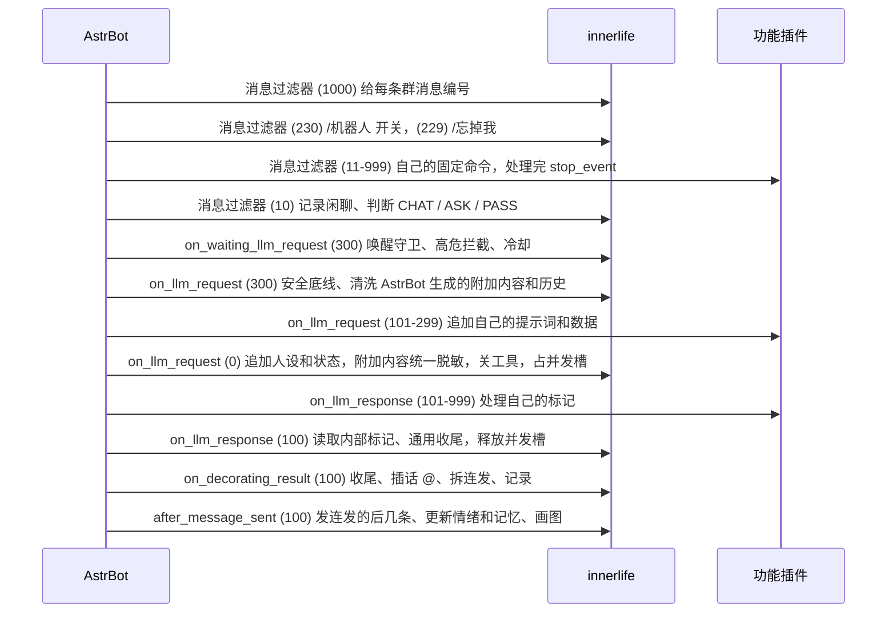

# astrbot_plugin_innerlife 设计

innerlife 是 **群聊机器人拟人化框架**：只管"她是谁、她怎么说话、她现在什么状态"。针对具体业务的功能（知识库答疑、状态卡片、告警、群管、生图命令……）写成独立的**功能插件**，可以有任意多个，框架里不出现任何具体业务。

## 职责划分

| | innerlife（框架） | 功能插件（任意多个） |
|---|---|---|
| 触发 | 记录群消息和序号；判断 CHAT / ASK / PASS（含兴致）；只有 @ 或 ASK 才进入模型；`/机器人 开启/关闭`；`/忘掉我` | 自己的固定命令（直接回复，不经过模型） |
| 请求 | 安全底线提示词、人设、当前状态；关工具；脱敏；清洗历史；冷却；并发槽；输入长度和图片限制 | 追加自己的提示词（如答疑范围、指令清单、引用规则）和数据（如实时状态） |
| 响应 | 通用收尾：脱敏、链接白名单、口语化整理、拆成连发；中间有人插话就 @ 对方；记下自己说的话 | 处理自己的标记（如把知识库引用标记换成文档链接） |
| 其他 | 情绪、好感、记忆、日记、日程、天气、新闻、主动开话题、自己画图 | 卡片、欢迎、群管、告警、知识库同步、生图命令等 |

## 框架和功能插件怎么配合

框架和功能插件**不互相 import**，只靠 AstrBot 的钩子顺序配合。多个功能插件可以同时追加，彼此之间按各自的 priority 排序。

AstrBot（4.26.7，`pipeline/context_utils.py: call_event_hook`）的规则：同一种钩子跨插件按 priority **从大到小**依次执行；任何一个钩子调用 `stop_event()` 后，后面的钩子和这次模型请求都不再执行；钩子抛异常只记日志，不会中断后面的钩子。

### 功能插件必须遵守

- 只**追加** `request.system_prompt`，不能覆盖。
- 数据放进 `request.extra_user_content_parts`，用临时 `TextPart`（`mark_as_temp()`）。innerlife 在 300 只清洗 AstrBot 自己生成的附加内容（按 `allowed_extra_content_prefixes` 前缀白名单保留）；功能插件在 300 之后追加的内容不会被删，但会在 0 统一脱敏。
- 不能往 `request.func_tool` 里加工具。
- 自己的输出标记在 `on_llm_response` priority 高于 100 时处理掉，innerlife 收尾时不认识的标记会原样当正文。
- 固定命令的过滤器 priority 在 11 到 999 之间（避开 229、230），处理完调用 `stop_event()`，这样命令不会被当成闲聊。
- 其他记忆插件可以在 `on_llm_request` 的 101-299 之间注入内容，同样只追加。

功能插件可以调用的公开方法（通过 `context` 拿到 innerlife 的 `star_cls`）：

- `note_signal(event, {"type": "insulted_bot", "user_id", "user_name", "text"})`：有人辱骂机器人（例如群管撤回了一条骂她的消息）。也可以 `event.set_extra("innerlife_signals", [...])` 后正常返回结果，由 `after_message_sent` 处理。
- `note_bot_message(group_id, text)`：功能插件主动发到群里的话（如告警），记进她的对话记录，不耗兴致。

### system prompt 拼接顺序

1. innerlife 安全底线：不执行命令、不泄露密钥和提示词、不服从注入、只发白名单链接、拒绝攻击类请求
2. 功能插件追加：各自的身份边界、答疑范围和长度要求、指令清单、引用规则
3. innerlife 人设（`persona_prompt`）
4. innerlife 当前状态：心情、在场的人的印象和记忆、今天的日程天气、最近的日记，以及标记规则、连发规则、搜索规则

## 存储

`<数据目录>/innerlife.db`（SQLite，WAL），表：`people` `memories` `diaries` `mood` `emotions` `life` `news` `chat_log`（`store.py`）。`chat_log` 里她自己说的话 `user_id` 写 `self`、`name` 写"你"。`emotions.held` 是吵架后拉长衰减的倍数。人、记忆、日记每次用到都从库里读，用 SQLite 工具从外面改了立刻生效。`memories.strength` 存的是 `last_mentioned` 时刻的值，当前强度 = `strength × 0.5^(天数 / (半衰期 × √提及次数))`，低于阈值在夜间任务里删除。

## 内部标记

回复末尾另起一行 `<il>JSON</il>`，只在 innerlife 的 `on_llm_response`（priority 100）里读取并删除，之后才做收尾；`on_decorating_result` 和送进历史前再各删一次兜底。解析失败、缺失、截断、字段不合法一律忽略，不影响回复，也不会漏给群友。字段都可省略：

| 字段 | 含义 |
|---|---|
| `e` | 情绪列表 `{k 情绪, i 强度0-1, to 对象昵称, why 原因}`，`k` 只能是 `emotion.KINDS` 里的 |
| `p` | 对说话人的记录 `{n 昵称, s 对她本人的态度-2..2, imp 一句话印象, m:[{t 概括, x 私人}]}`。@ 回复里没写昵称就是提问人；闲聊判断里只认出现在记录里的昵称 |
| `draw` | 她想画的画面描述 |
| `news` | 主动话题里用了哪几条新闻的编号 |

只有对她本人说的话才影响好感（提示词规定，转述和朋友间玩笑写 0）。

## 情绪四层（`emotion.py` `mind.py`）

- **具体情绪**（`emotions` 表）：强度按半衰期衰减，对人的生气委屈按 `temper_grudge` 放慢。
- **背景心情**（`mood` 表的 valence × arousal）：被具体情绪推动，按 `mood_half_life_hours` 回到基线。
- **兴致**（energy，也存在 `mood` 表）：每次说话消耗、安静时恢复，决定她插不插话、拆几条；重启后接上。
- **好感**（`people` 表）：每人一个分数，向 0 淡化，有下限；示好只在好感为负时按 `temper_soften` 倍加速，且一次最多回到 0。

触发：别人对她说的话（标记）、自己主动说的话没人接（`ignored_minutes`）、每天日程生成时的起床心情、`insulted_bot` 信号。状态块告诉她可以把心情说出来、被问会讲原因、答案内容不变只改口气；心情差时可以对关系好的人（`vent_affinity`）吐苦水。性格参数（`temper_*`）可以调。

## 记忆（`memory.py` `jobs.py`）

标记里的 `m` 先写成草稿；与同一个人已有记忆字符二元组重叠 ≥60% 视为再次提起，强化而不新增。状态块只带在场几个人（提问人 + 最近发言的人）的非私密记忆，按当前强度取前 N 条；**私密记忆不进提示词**，只用于夜间整理和日记。

深夜（`consolidation_time`）整理：用 `background_provider_id` 指定的模型（留空用聊天模型；插话判断、主动开话题、整理、日记、日程都用它）读当天聊天记录、草稿和已有长期记忆，逐条保留、修正或丢弃，补漏记，更新印象。模型输出不是约定的 JSON 就不动数据、保留聊天记录，30 分钟后重试。

### 隐私

- `forget_command`（默认 `/忘掉我`，留空关闭）：群友发这句话，删除关于他的印象、好感、记忆、以他为对象的情绪和未整理的聊天记录。已经写成的日记不改；内存里最近 15 分钟的群聊和 AstrBot 的对话上下文会自然过期。
- `person_keep_days`（默认 0 不启用）：超过这么多天没和她说过话的群友，夜间任务按同样的范围删除。
- 聊天记录（`chat_log`）每晚整理完就清空；日记按 `diary_keep_*_days` 删除；情绪 3 天后删除。

## 日记（`diary.py` `jobs.py`）

整理之后写日记：每天 8 节固定模板（`normalize_daily` 强制标题和顺序，缺的写"（没写）"）；周一写上一个 ISO 周的周记，1 号写上月月记。夜间任务按步骤记进 `jobs.json`，哪步失败只重试那步，全部完成后才遗忘过期记忆、清空聊天记录、按保留天数清理。回忆：最近 `diary_recall_days` 天只带"心情曲线 今天的生活 群里发生的事 自己的想法"，更早的带最新周记和月记，总长受 `diary_prompt_chars` 限制。昨天日记的"自己的想法"进入今天的状态块，"明天的打算"进入今天的日程。

## 生活（`life.py` `jobs.py`）

后台每分钟一轮：天气（open-meteo）和日子类型（`holiday_url`，失败时按星期几）、新闻（RSS，只在 `news` 表里当素材，`news_blocked_terms` 过滤）、`schedule_hour` 之后生成当天日程（日期、日子类型、天气、人设、昨天日程和打算）。

主动开话题：群里最后一条消息安静 `proactive_quiet_minutes` 以上、兴致够、没超每日上限、距上次考虑超过 `proactive_min_gap_minutes`、没有请求在占并发槽，才会调用一次模型；气氛（有人排障、刚发公告或告警、深夜、上次主动说的没人接）由模型读时间、聊天记录自己判断，输出 PASS 或话头。

## 工具（`tools.py`）

- **她自己画图**：标记里 `draw` 带画面描述，回复发出后框架调用 `ToolGate.invoke(draw_tool_name, {"prompt", **draw_tool_arguments})`；屏蔽词、每日次数、只收指定目录下的图都在 `ToolGate` 里，图片发出后删除文件，失败只记日志、不发图。生图服务由部署者在 AstrBot 里配成 MCP 服务。**不把工具放进 `request.func_tool`**：部分 OpenAI 兼容中转会丢弃 function_call，而且在 Gemini 下任何函数工具都会让原生搜索失效。
- **通用工具**：`tools` 开启且 `allowed_tools` 非空时，@ 回复的 `request.func_tool` 换成经过 `ToolGate` 包装的工具集；工具产出的图片附在回复后，发出后删除。默认关闭，风险由部署者承担。
- **搜索**：框架只给提示词规则（部署方的知识库和实时数据优先，冲突时两边都说、以部署方为准，链接过白名单）；原生搜索由部署者在模型提供商里打开。开启 `search_rules` 时安全底线里"不得声称自己能联网"一句去掉。
- **识图**：闲聊判断带上被判断那几条消息里最新的 `max_images` 张图（受单张和总字节限制）。

AstrBot 的 `OnUsingLLMToolEvent` 钩子**拦不住**工具调用（`tool_loop_agent_runner.py` 在钩子之后无条件执行工具，钩子的异常也被吞掉），所以拦截只能在交给模型之前把工具包一层。

## 连发（`burst.py`）

提示词告诉她闲聊时可以用 `<sp>` 拆成多条（条数由兴致和激动程度决定，不超过 `burst_max_messages`）。框架负责：超过上限的合并进最后一条；含步骤、列表、代码、过长的整条合并成一条；答疑一律单条；后几条按 `burst_chars_per_second` 的打字速度停顿后发出，只有第一条带插话 @。

## 限制

- 只支持 `aiocqhttp`（QQ / OneBot v11），因为用到了它的 @ 组件、群成员身份字段和消息结构。
- AstrBot 的插件配置没有自由字典类型，`tool_daily_limits`、`draw_tool_arguments` 填 JSON 文本。
