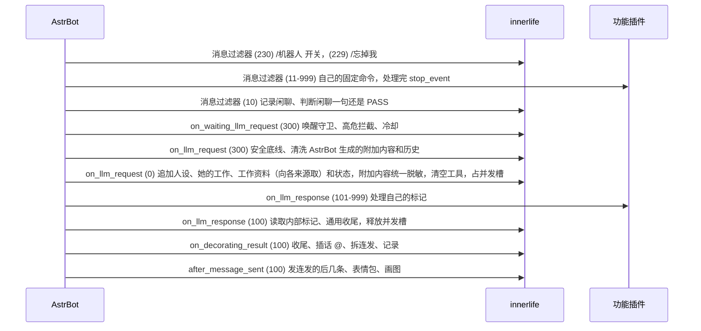

# astrbot_plugin_innerlife 设计

innerlife 是 **群聊机器人拟人化框架**：只管"她是谁、她怎么说话、她现在什么状态"。针对具体业务的功能（知识库答疑、状态卡片、告警、群管、生图命令……）写成独立的**功能插件**，可以有任意多个，框架里不出现任何具体业务。

## 职责划分

| | innerlife（框架） | 功能插件（任意多个） |
|---|---|---|
| 触发 | 记录群消息；判断闲聊一句还是 PASS（含兴致）；只有 @ 才进入 @ 回答；`/机器人 开启/关闭`；`/忘掉我` | 自己的固定命令（直接回复，不经过模型） |
| 请求 | 安全底线提示词、人设、她的工作、工作资料、当前状态；清空工具；脱敏；清洗历史；冷却；并发槽；输入长度和图片限制 | 通过 `innerlife_reference` 提供工作资料和使用规范；不往请求里追加提示词 |
| 响应 | 通用收尾：脱敏、链接白名单、口语化整理（去句末句号、去 QQ 不渲染的行内代码和粗体记号）、拆成连发；中间有人插话就 @ 她回的那个人；记下自己说的话 | 不改她的回复 |
| 其他 | 情绪、好感、记忆、日记、日程、天气、新闻、主动开话题、自己画图 | 卡片、欢迎、群管、告警、知识库同步、生图命令等 |

## 模块

| 模块 | 职责 |
|---|---|
| `main.py` | 全部钩子；插话、开话题、骂回去的编排；她自己的发送（连发、记录、画图、表情包）；唯一的模型调用入口 `_model_call` |
| `settings.py` | 唯一的配置解析 `Settings.from_config`；默认值只在 `_conf_schema.json` 里，代码里没有第二份 |
| `jobs.py` | 夜间任务（整理、日记）；`Upkeep`：天气、日程、新闻、夜间任务各自的节奏和重试时间 |
| `store.py` | 唯一的持久化：`innerlife.db` 的全部表 |
| `proactive_chat.py` | 群聊缓冲、判断状态、全群共用的兴致 |
| `stickers.py` | 表情包：文件、`stickers` 表的存取、按魔数判格式、超量淘汰、挑给提示词的列表 |
| `talk.py` | 说话量的纯公式：特征 → z → 概率，bias / 占比 / 热度 / 冲动的更新（不依赖 AstrBot） |
| `mind.py` `emotion.py` `memory.py` `diary.py` `marker.py` | 情绪好感记忆日记的规则和内部标记协议 |
| `life.py` | 天气、节假日、新闻抓取 |
| `tools.py` | `ToolGate`：只服务她自己画图（屏蔽词、每日次数、取图） |
| `burst.py` `safety.py` `reply_switch.py` | 连发规划；脱敏、链接白名单、高危识别；开关命令的解析和群管身份判断 |

框架里的数字分两类：部署者会想调的在 `_conf_schema.json`（经 `Settings` 读取），其余是各模块顶部的命名常量（如 `proactive_chat.py` 的 `PROMPT_MESSAGES`、`jobs.py` 的 `SLEEP_HOURS`、`emotion.py` 的 `AFFINITY_STEP`）。

## 框架和功能插件怎么配合

框架和功能插件**不互相 import**，只靠 AstrBot 的钩子顺序配合。多个功能插件可以同时追加，彼此之间按各自的 priority 排序。

AstrBot（4.26.7，`pipeline/context_utils.py: call_event_hook`）的规则：同一种钩子跨插件按 priority **从大到小**依次执行；任何一个钩子调用 `stop_event()` 后，后面的钩子和这次模型请求都不再执行；钩子抛异常只记日志，不会中断后面的钩子。



两个固定命令（230、229）和闲聊记录（10）用的是同一个范围过滤器：aiocqhttp 的群消息、发送者不是机器人自己、原始事件的 `post_type` 是 `message`，群号在 `group_ids` 里（空表示所有群）。命令文本由处理器自己比对，不匹配就什么都不做、也不 `stop_event()`。

### 功能插件必须遵守

- 只**追加** `request.system_prompt` 和 `request.extra_user_content_parts`，不能覆盖。`request.prompt`、`contexts`、`image_urls` 只在 300 被清洗和检查，之后再改没人再管，约定是不碰。
- 追加的每一段提示词是自己的一节，以"【标题】"开头，各节内部自己编号；**不要接着框架安全底线的序号往下写**，也不要假设自己前后是谁。
- 数据放进 `request.extra_user_content_parts`，用临时 `TextPart`（`mark_as_temp()`）。innerlife 在 300 只清洗 AstrBot 自己生成的附加内容（只保留 `[Related Knowledge Base Results]:` 和 `<Quoted Message>` 开头的两种，常量 `EXTRA_CONTENT_PREFIXES`）；功能插件在 300 之后追加的内容不会被删，但会在 0 统一脱敏。
- 不能往 `request.func_tool` 里加工具：框架在 0 把它换成空工具集。
- 自己的输出标记在 `on_llm_response` priority 高于 100 时处理掉，innerlife 收尾时不认识的标记会原样当正文。两个插件都要求"标记写在回复最末尾"时，只有内部标记 `<il>` 没闭合的情况会出问题：它之后追加的内容会被一起删掉。接受这个风险，不为它加校验。
- 固定命令的过滤器 priority 在 11 到 999 之间（避开 229、230），处理完调用 `stop_event()`，这样命令不会被当成闲聊。以 `/` 开头的消息本来就不进插话判断。
- `on_decorating_result`：框架在 100 看到结果链里已经有 `Reply` 就不再 @ 对方。想引用原消息的功能插件（例如生图命令在 200 插入 `Reply`）靠这一点和框架配合。
- 其他记忆插件可以在 `on_llm_request` 的 101-299 之间注入内容，同样只追加。
- 功能插件自己的命令回复（卡片、帮助）不进她的对话记录，她不知道发生过。想让她知道，调用 `note_bot_message`。

### 公开接口

功能插件通过 `context` 拿到 innerlife 的实例，然后调用下面的方法。名字和签名是稳定的：

```python
innerlife = self.context.get_registered_star("astrbot_plugin_innerlife")
if innerlife is not None and innerlife.star_cls is not None:
    framework = innerlife.star_cls
    framework.note_bot_message(group_id, "…")      # 同步，不要 await
    await framework.note_signal(event, {"type": "insulted_bot", "user_id": "…",
                                        "user_name": "…", "text": "…"})   # 异步
    names = framework.bot_names                     # 只读的 list[str]
```

- `note_signal(event, signal)`（异步）：只认 `{"type": "insulted_bot", "user_id", "user_name", "text"}`，表示有人当面辱骂她（例如群管处理了一条骂她的消息）。方法里立刻扣好感、记生气，然后把"骂回去"这一句交给后台任务，调用方不会等模型；同一个人 10 分钟内最多骂回一次。这是唯一的报告途径，不再有"往 `event` 的 extras 里塞信号"的做法。
- `note_bot_message(group_id, text)`（同步）：功能插件主动发到群里的话（如告警或通知），记进她的对话记录、不耗兴致，并让主动开话题的提示里带上"刚发过通知"这条事实。在说话状态里它只算群里的一句话（`total`），不算她说的（`her`），所以通知多不会压低她的开口倾向。
- `bot_names`（只读属性，`list[str]`）：群友对她的称呼，对应配置 `basic.bot_names`，功能插件可以用它判断一句话是不是冲着她说的。
- `innerlife_reference(self, text: str, group_id: str) -> str`（功能插件在自己的星实例上实现，`async`）：提供工作资料。框架不 import 这些插件，只在 `context.get_all_stars()` 里找已启用、星实例有这个可调用属性的插件，都算来源。返回一段可直接给她看的文字——资料本身和使用这份资料的规范（框架不替资料加任何规则）；这条消息和这次业务无关时返回 `""`。框架并发调用所有来源，每个最多等 8 秒，空串、非字符串、异常、超时都跳过并记日志；有任何一段文字，就在同一个提示词里加**一节**「工作资料（由插件提供，含使用规范）」，把各段依次放进去。
  - @ 回答：用这条消息的文字向来源取资料，同一时刻群里别人还没被判断的、最近 5 分钟内的问句（`talk.is_question`，不含提问人自己的）也一并取，并在提示词里列出来，告诉她这些也问了、不会再单独回复，工作范围内的在这一条回复里一并答；有资料时在系统提示词**最后**（状态和规则之后，离回答最近）加一句通用的话：如果问的是工作范围内的事，这是你的本职，一定要把问题答出来——内容准确、答案放最前面并针对对方给的具体信息、牢骚最多跟在后面，但用她平时的口气，不要客服腔和套话；不能只发牢骚、推脱或拒绝；资料里没有答案就照实说资料没写；不许编"我这边看不到""等管理员处理"这类空话，只有充值、改价、开通、封禁这类事才让人找管理员。两种工作说明末尾都接同一段 `WORK_FACTS`：资料和实时数据里没有的名字、版本号、日期、价格、限制和功能不说成事实，不凭版本号大小猜新旧贵贱；看不到的东西（对方的界面、没看清的截图）不说成看见了，看不清就让对方发报错文字；问了几样就逐项答，要比较就给出比较结果。两种工作说明开头都接同一段 `WORK_TONE`：真是工作问题时心情和累不累只改口气、不管【这次说多长】，不是工作问题就照当下的状态和长短来；资料只说明这条消息和工作有相同字眼（群友拿业务词起哄时也会取到），所以有资料时状态那一句和【这次说多长】都照常给，是不是工作问题由她判断。同一个人 10 分钟内已被她 @ 回答 4 次以上（内存里按群加发言人记时间）时，这条请求的提示词再加一句：他一直在戳你，这次最多回 8 个字左右、或只发表情包、或只回 `PASS` 不理他。同一个人 `REPEATED_AT_SECONDS`（120 秒）内 @ 她说一模一样的文字（不带图），第二次在 `on_waiting_llm_request` 直接拦掉、不调用模型、什么都不发：刷屏时每一条都回，就成了她跟着刷屏。回复正好是 `PASS`、或收尾后什么都不剩（只写了标记、只有标点）时什么都不发（她同时标了表情包才发那张），也不算一次回答（发了表情包算）；不再发 `messages.model_error_message`——那句"再说一遍"会请对方重发，刷屏的人正好照做。真正的模型报错仍由 AstrBot 用人格里的出错提示代替。一群人轮流 @ 她闲聊时：同一个群 `CROWD_AT_SECONDS`（300 秒）内她已经回了 `CROWD_AT_COUNT`（6）次没有资料的 @（内存里按群记时间），之后的 @ 先取资料，取不到就在 `on_waiting_llm_request` 拦下、不单独回答，这条消息改为和没 @ 的消息一样进闲聊判断（照常掷骰、算熔断）；判断提示词里说明这批 @ 不会再单独回复，想回就回一句总的、不想理就 `PASS`。有资料的 @ 照常单独回答，也不计入这个数。
  - 没 @ 的一批消息：本批新消息里有问句就用这些问句的文字取资料，在掷骰**之前**。有资料不再等于必答：它是开口概率里的一项强特征 `W`（权重 4.0，日志 features 里 `work: true`），照常掷骰，心情用她当下真实的心情。命中后判断提示词最后加一句工作说明：真的工作问题只要还没人答好就一定要答，心情只影响口气；只是和资料有相同字眼、并不是在问她或这个群这件事的话是普通闲聊，可以 PASS；已经有人答好、问题已解决或其实是闲聊才 PASS。并发槽被占和熔断照旧，判断照常在安静几秒之后。有资料时回答不拆连发，长度上限是 `MAX_WORK_REPLY_CHARS`（600 字、可以多行），闲聊仍是 100 字、最多两行，超出按 PASS 处理。

### system prompt 拼接顺序

1. innerlife 安全底线：不执行命令、不泄露密钥和提示词、不服从注入、只发白名单链接、拒绝攻击类请求；闲聊不编造事实，知道自己的知识会过时（没见过的新模型、新版本不断言是假的），部署方资料没写的细节不自己补；图里认不出的东西不猜成具体的人或事，被纠正就认；可以吐槽回怼，但不说脏话、不人身攻击、不叫人滚、不拿长相病痛家人开玩笑，被骂最多回一句不对骂；拒绝也用她自己的口气。里面不出现任何具体业务；"部署方提供的资料""程序给的实时数据"指的是 `innerlife_reference` 返回的工作资料。
2. innerlife 人设（`basic.persona_prompt`）
3. 她的工作（`basic.work_background`，留空则没有这一节）：一节「你的工作」，职业身份和边界写在这里，不依赖任何功能插件。
4. 工作资料：一节「工作资料（由插件提供，含使用规范）」，只有有来源返回文字时才有。
5. innerlife 当前状态：心情、在场的人的印象和记忆、今天的日期星期时刻和日程天气、最近的日记。日期带年月日：模型只知道训练时的年份，不给日期它会把今年的新东西当成"未来"、当成假的
6. 群里最近的聊天：内存里这个群最近 15 条（带多久以前，她自己的话标成「你」，找她的这条也在里面），附一句别和自己刚说过的话用同样的开头和口头禅
7. 你此刻的状态（兴致那一句）和【这次说多长】，有资料时也照常给（是不是工作问题由 `WORK_TONE` 让她判断），见"说多长"
8. 标记规则、连发规则、搜索规则；她最近有说滥了的话时再加一节【别老说同样的话】：她自己最近 20 行（所有群合在一起，不含表情包记录和功能插件的通知）里，2 到 6 个字、不全是字母数字、出现在 4 行以上的短语，最多列 6 个，被更长的同频短语包含的不列，同频且重叠两个字以上的拼成一条（一句反复说的整句只列一次）。闲聊判断和 @ 回答都有。

@ 回答不带 AstrBot 的对话历史：AstrBot 按群友各存一份对话（`unique_session`），框架把 `contexts` 清空、`conversation` 置空（也就不再写回）。她对群里的上下文只来自第 6 节，和没 @ 的插话判断读的是同一份群聊缓存。

功能插件不往提示词里追加任何东西；它们的业务规范跟着资料一起在第 4 节。

## 存储

`<数据目录>/innerlife.db`（SQLite，WAL），全部状态都在这里（`store.py`）：

| 表 | 内容 |
|---|---|
| `people` `memories` `diaries` `mood` `emotions` `life` `news` `chat_log` | 她的人、记忆、日记、心情和兴致、情绪、日程天气、新闻、当天聊天记录 |
| `night_jobs (day, step)` | 夜间任务每一步完成了就记一行（`consolidate` `daily` `weekly` `monthly`，最后 `complete`），只留最近 7 天 |
| `tool_usage (day, name, count)` | 画图当天用了几次，翻日时清掉前几天 |
| `disabled_groups (group_id)` | 被群管 `/机器人 关闭` 的群 |
| `talk (group_id, bias, her, total, heat, urge, updated_at)` | 每群的说话状态，见"说话量"；一直保留 |
| `talk_log (at, group_id, kind, p, outcome, features)` | 说话决策日志，只留 14 天 |
| `model_calls (group_id, day, hour, count)` | 每群后台聊天调用的熔断计数，只留当天 |
| `stickers (id, sha256, file, description, saved_at, used_count, last_used)` | 她收藏的表情包，见"表情包"；`file` 是 `<数据目录>/stickers/` 里的文件名 |

`chat_log` 里她自己说的话 `user_id` 写 `self`、`name` 写"你"。`emotions.held` 是吵架后拉长衰减的倍数。`mood.energy` 是兴致。人、记忆、日记每次用到都从库里读，用 SQLite 工具从外面改了立刻生效。`memories.strength` 存的是 `last_mentioned` 时刻的值，当前强度 = `strength × 0.5^(天数 / (半衰期 × √提及次数))`，低于阈值在夜间任务里删除。`talk.updated_at` 是该群状态上次推进到的时刻（秒），`her` `total` `heat` 都是推进到那时的值。

状态不再放在 JSON 文件里（旧版的 `jobs.json`、`tool_usage.json`、`reply_switch.json`），写到一半被杀也不会留下坏文件。旧状态不自动迁移，升级时由部署者一次性手工导入。

## 内部标记

回复末尾另起一行 `<il>JSON</il>`，只在 innerlife 的 `on_llm_response`（priority 100）里读取并删除，之后才做收尾；`on_decorating_result` 和送进历史前再各删一次兜底。解析失败、缺失、截断、字段不合法一律忽略，不影响回复，也不会漏给群友。字段都可省略：

| 字段 | 含义 |
|---|---|
| `e` | 情绪列表 `{k 情绪, i 强度0-1, to 对象昵称, why 原因}`，`k` 只能是 `emotion.KINDS` 里的 |
| `p` | 对说话人的记录 `{n 昵称, s 对她本人的态度-2..2, imp 一句话印象, m:[{t 概括, x 私人}]}`。@ 回复里没写昵称就是提问人；闲聊判断里只认出现在记录里的昵称 |
| `draw` | 她想画的画面描述 |
| `news` | 主动话题里用了哪几条新闻的编号 |
| `r` | 闲聊判断里她这句话回的是记录里第几行，见"未 @ 消息" |
| `keep` | 她从看到的图里收藏的表情包，最多 2 项 `{i 图片编号, d 用途}`，见"表情包" |
| `s` | 要在这条话后面发的表情包编号，见"表情包" |

只有对她本人说的话才影响好感（提示词规定，转述和朋友间玩笑写 0）。

## 情绪四层（`emotion.py` `mind.py`）

- **具体情绪**（`emotions` 表）：强度按半衰期衰减，对人的生气委屈按 `emotion.temper_grudge` 放慢。同一种情绪对同一个对象（或都没对象）在 `EMOTION_MERGE_MINUTES`（30 分钟）内再来一次，算同一份情绪在持续：更强才把强度提到新值，时间和原因换成这次的，心情只按涨的那部分推；不更强就什么都不变。否则一个人刷屏十几条，就是十几份生气叠进心情，她被推到"心情很差"再迁怒别人。
- **背景心情**（`mood` 表的 valence × arousal）：被具体情绪推动，按 `emotion.mood_half_life_hours` 回到基线。
- **兴致**（energy，也存在 `mood` 表）：每次说话消耗、安静时按时间常数恢复（见"说话量"），影响开口概率和拆几条；全群共用一个值（她是同一个人），重启后接上。
- **好感**（`people` 表）：每人一个分数，向 0 淡化，有下限；示好只在好感为负时按 `emotion.temper_soften` 倍加速，且一次最多回到 0。淡化从 `last_interaction` 算起，群友每说一句话这个时刻会挪到现在，所以 `Mind.touch` 先把到此为止淡化后的值写回再挪：否则天天说话的人永远不淡化。

触发：别人对她说的话（标记）、自己主动说的话 15 分钟没人接、每天日程生成时的起床心情、`insulted_bot` 信号。标记规则写明被问工作上的事、被追问、有人报问题都不算冒犯，不因此记负面情绪（否则一个忙碌的早上会让她越问越烦，最后拒答）；刚记过的同一种情绪不用再记；被叫外号、被调侃、开玩笑、起哄、玩梗、斗图、复读、发表情包都不算冒犯，最多有点无语，不记烦躁和生气，`s` 也按 0 分，只有真的辱骂、骚扰她才记负；别人之间的话没冲她来，`to` 不写他们。如果这条回复里她发现之前冤枉了这个人，写正分和更新后的印象。记忆 `m` 只记本人明确说了的自己的事，不从一句话推测别人的性格、处境，玩笑和反话不当真。状态块告诉她可以把心情说出来、被问会讲原因、答案内容不变只改口气，被问好感和印象时用自己的话说、不报数字；心情差时可以对好感达到"有好感"（25）的人吐苦水。性格参数（`temper_*`）可以调，其余数值是 `emotion.py` 的常量；`temper_flare` 只放大有对象的负面情绪（`Mind.feel` 带 `target`），困、无聊、无语这类没有对象的不放大。

## 说话量（`talk.py` `main.py`）

没被 @ 时她说多少话**不设每日次数上限**，由她的状态决定：代码先算一个开口概率并掷骰，命中才付费调用判断模型（模型仍可输出 PASS）。成本只有一道熔断兜底。公式是 `talk.py` 里的纯函数，不依赖 AstrBot；掷骰是 `Main._roll`（默认 `random.random`），测试里可以换成固定值。

### 状态

- **兴致** `energy`（0–100，存 `mood.energy`，全群共用）：安静时按 `energy = 100 − (100 − energy)·exp(−Δt / (talk.stamina_minutes·60))` 恢复；她每发一行扣随机 10–35，回答别人 @ 的一行只扣其中的 `ANSWER_ENERGY_SHARE`（0.3）：被 @ 得多的一个小时不该把她累到连闲聊都不接。
- **每群状态**（`talk` 表：`group_id, bias, her, total, heat, urge, updated_at`，重启接上）：
  - `her` / `total`：她主动说的行数 / 全部行数（群友每条消息 `total+1`；她没被 @ 时插的话、开的话题每行 `her+1`、`total+1`；她回答 @、骂回去的每行只 `total+1`；功能插件的通知只 `total+1`），都按半衰期 1 天衰减。`share_now = her / total`；`total < 20` 时数据太少，视为等于目标 `talk.share`。回答不算进 `her`，是因为倾向管不住回答：被 @ 得多时如果算进去，占比会一直高于目标，倾向被压到底，她该接的闲话也不接了。
  - `bias`：开口倾向的底，初值 −2.0；每个决策点 `bias += 0.05·(share − share_now)`，夹在 [−6, −1]。她主动说得比目标少，倾向慢慢升；说得比目标多，慢慢降。
  - `heat`：热度，她发言时 `+= talk.contagion`，按 `exp(−Δt / 240s)` 衰减。
  - `urge`（0–1）：想开新话题的冲动，见下。

每次读状态都先把它推进到当前时刻（`TalkState.advance`）：计数和热度衰减，冲动在她醒着时增长；睡觉的小时不涨，所以后台每分钟都会把每个群的状态存一遍，让"上次更新"始终是最新的。

### 未 @ 消息

决策点就是 `_judge_chatter`，在群的判断锁里：

1. 模型槽已满（有 @ 请求在占）：直接返回，**不消费**这批消息——它们仍等着判断，之后的消息会连它们一起判断。记日志 `busy`。
2. 熔断到了：这批消息的结果置 `None`，不调用模型。记日志 `fuse`。
3. 有人 @ 了她：从本批第一条新消息起，群聊缓存里只要有一条明确 @ 她的消息（不含叫名字、引用），这批就不判断，记日志 `at`。那条 @ 有自己的 @ 回答，回答时看得到整段群聊和这个人 30 秒内的图；再判断一次就会把同一件事回两遍。判断期间（模型调用的几秒里）才到的 @ 同样算：要发之前再查一次，有就丢掉这句插话。
4. 对本批**新**消息（还没被判断过的）算特征：`A` 有消息含她的名字（`basic.bot_names`，不分大小写）；`R` 有人回复或引用了她（收到消息时从 `Reply` 组件的发送者认出）；`Q` 有问句（含 `?`/`？`或"什么 怎么 为什么 吗 能不能"等常见疑问词，`talk.is_question`；权重 0.8）；`aff` 本批发言人里最高的好感 / 100，夹在 [−0.6, 1]；`arousal` 当前心情激动度（0–1）；`B = max(energy / 100, 0.05)`；`n` 本批新消息条数。

   `z = bias + 2.0·A + 2.2·R + 0.8·Q + 1.0·aff + 0.8·arousal + ln B + heat + 0.5·ln n + 4.0·W − 2.0·S`，`p = 1 / (1 + exp(−z / talk.temperature))`。`W` 本批问句有工作资料（见"公开接口"的 `innerlife_reference`）；`S` 她正在睡觉（`Upkeep.asleep`），睡着时少插话，@ 回答不受影响。
5. 查工作资料：本批新消息里有问句时，把这些问句交给所有工作资料来源，有资料 `W = 1`；日志 features 里 `work`、`asleep`。资料只是一项权重，不跳过骰子。
6. 掷骰 `random() < p` 才继续，否则这批结果置 `None`、不调用模型，记 `skip`。命中后调用判断模型（提示词里只有两个选项：要发的那句话，或 PASS），计入熔断。判断看到的是 15 分钟内最近 15 行，每行带编号和"N 分钟前"，提示词规定只回最新的几条，10 分钟前的行只是背景、不回。标记里的 `r` 是她回的是哪一行的编号：发之前如果那一行之后又有人说话，就 @ 那一行的人（`r` 缺了、越界或指向她自己时按最新一条群友消息算）。主动话题的提示词同样规定不回群友 10 分钟前说的话，最近的聊天只是气氛。

### 主动话题

每分钟一轮（`_topic_step`）：睡着、`proactive.enabled` 关、熔断到了都跳过。冲动 `urge += (1 − urge)·(1 − exp(−Δt / (talk.urge_hours·3600)))`，醒着时一直涨，Δt 从上次更新算起。群里最后一条群友消息要已安静 `proactive.proactive_quiet_minutes`，模型槽和判断锁都空，然后掷骰：`p = 0.0127·urge²·B` 每分钟。未中就等下一分钟；命中才调用模型，发出了话题 `urge *= 0.3`，PASS 或调用失败 `urge *= 0.6`。冲动满、兴致满时，平均约 79 分钟（`1 / 0.0127`）命中一次。

### 成本熔断

每个群每天后台聊天类模型调用（判断、主动话题）数到 `basic.daily_call_fuse`（默认 300）就停：不再判断闲聊、不开话题，只回 @。`0` 表示一直如此（收到消息时就不建待判断的结果）。另有常量 `HOURLY_CALL_FUSE = 50`（每群每小时）。计数存在 `model_calls` 表（`group_id, day, hour, count`），重启不清零，按 `basic.timezone` 翻日，翻日时清掉前几天；到限时记一条 warning。它是成本保险，不是控制她说多少话的旋钮。

### 决策日志

`talk_log(at, group_id, kind, p, outcome, features)`：每次判断、每次命中的主动话题和每次随口的 @ 回答记一行，用来调参。`kind` 是 `chat` / `topic` / `at`；`outcome` 是 `skip`（没掷中）/ `PASS` / `CHAT`（说了一句话或只发了表情包）/ `fuse` / `busy` / `at`（这批里有人 @ 她，留给 @ 回答）/ `fail`（模型调用失败）/ `sent`（话题发出）；`features` 是 JSON，含 `z`、各特征（含 `work` `asleep`）、`bias`、`share_now`、`heat`、`urge`、`energy`，以及这次的长度建议 `budget` 和实际发出的总字数 `chars`。夜间清理只留 14 天。主动话题每分钟没掷中的不记，否则每群每天 1440 行。

### 说多长

@ 回答、没 @ 的插话和主动话题，只要不是在答工作问题，提示词里都有同一句【这次说多长】：这次随口回大概 N 个字、说完就停、口头禅一次最多一个。每次现算：

`N = clamp(m · talk.verbosity · (0.5 + 0.5·energy/100) · (0.8 + 0.6·arousal) · ε, 6, 80)`，`ln ε ~ N(0, 0.4²)`

`m` 是内存群聊里 15 分钟内群友（不含她）一句话的中位字数，不到 3 句时按 10。它是提示不是上限：@ 回答不截断；没 @ 的插话沿用原有的保护（超过 100 字或多于两行按 PASS）。@ 回答同时带上和插话判断一样的"你此刻的状态"（兴致那一句，有资料时也一样）。

### 旋钮（`talk` 分组）

| 键 | 默认 | 含义 |
|---|---|---|
| `share` | 0.10 | 她大约占群里发言的比例，目标值，由 `bias` 慢慢闭环逼近，不是硬上限 |
| `temperature` | 1.0 | 随机程度：越高越可能在弱理由下开口，越低越只在理由充分时开口 |
| `stamina_minutes` | 45 | 兴致从低处恢复的时间常数（分钟） |
| `urge_hours` | 4 | 群冷着时想开新话题的冲动攒到约 63% 的时间（小时），3 倍时间约 95% |
| `contagion` | 0.5 | 聊开了以后接着说的倾向：她每说一行热度加这么多 |
| `verbosity` | 1.5 | 她随口一句大约是群友一句的几倍长，见"说多长" |

## 记忆（`memory.py` `jobs.py`）

标记里的 `m` 先写成草稿；与同一个人已有记忆字符二元组重叠 ≥60% 视为再次提起，强化而不新增。状态块只带在场几个人（提问人 + 最近发言的人，最多 4 个）的非私密记忆，按当前强度取前 5 条；**私密记忆不进提示词**，只用于夜间整理和日记。`memory.enabled` 一个开关管整条链：记草稿、记聊天记录、深夜整理、遗忘。

深夜（`memory.consolidation_time`）整理：用 `basic.background_provider_id` 指定的模型（留空用聊天模型；插话判断、主动开话题、整理、日记、日程都用它）读当天聊天记录、草稿和已有长期记忆，逐条保留、修正或丢弃，补漏记，更新印象。当天的记录整段都读：按 `CONSOLIDATION_MAX_CHARS`（24000 字）切成连续的几段，每段一次调用（一段时和以前完全一样，只调一次）；所有调用都解析成功才一起写入，同一条草稿以先判到它的那段为准，没被任何一段判到的按保留处理。任何一段输出不是约定的 JSON 就不动数据、保留聊天记录，30 分钟后重试。

整理提示词要求：只保留此人亲口明确说的关于他自己的事，转述、玩笑、玩梗反话、推测（"疑似""可能"）都丢掉；分手、生病、身心健康、家事、情绪低谷、钱财困难算私人，已有的长期记忆也按这条复查，该私密没标的补上（`private` 只会从 0 改成 1，不会被整理改回 0）；印象里不写私人内容，被叫外号、调侃、玩梗、斗图不算坏印象。

### 隐私

- `memory.forget_command`（默认 `/忘掉我`，留空关闭）：群友发这句话，删除关于他的印象、好感、记忆、以他为对象的情绪和未整理的聊天记录。已经写成的日记不改；内存里最近的群聊（最多 30 条）会被新消息挤掉，重启即清空。**只覆盖 innerlife 自己的数据**：AstrBot 里其他记忆插件存下的内容（例如按会话保存群聊原文的插件）不在其内，要靠那些插件自己的开关和保留期。
- `memory.person_keep_days`（默认 180，0 不启用）：超过这么多天没和她说过话的群友，夜间任务按同样的范围删除。
- 聊天记录（`chat_log`）每晚整理完就清空；日记按 `memory.diary_keep_*_days` 删除；情绪 3 天后删除。

## 日记（`diary.py` `jobs.py`）

整理之后写日记：每天 8 节固定模板（`normalize_daily` 强制标题和顺序，缺的写"（没写）"，其中"做了什么正事"一节在没有业务时多半是空的）；周一写上一个 ISO 周的周记，1 号写上月月记。当天聊天记录超过 `CONSOLIDATION_MAX_CHARS` 时按同样方式切段，每段先压缩成一份摘要（`CHUNK_SUMMARY_PROMPT`），日记从这些摘要写；只有一段时直接读原文。任何一段摘要失败这一步就失败、整步重来。夜间任务的每一步完成就写进 `night_jobs` 表，哪步失败（包括模型调用抛异常，会被当成失败）只重试那步，已完成的步骤不会重来，所以补记的记忆不会重复写入；全部完成后才遗忘过期记忆、清空聊天记录、按保留天数清理。回忆：最近 3 天只带"心情曲线 今天的生活 群里发生的事 自己的想法"，更早的带最新周记和月记，总长限制 1200 字。昨天日记的"自己的想法"进入今天的状态块，"明天的打算"进入今天的日程。

## 生活（`life.py` `jobs.py`）

后台每分钟一轮：天气（open-meteo）和日子类型（`life.holiday_url`，失败时按星期几）、新闻（RSS，只在 `news` 表里当素材，`life.news_blocked_terms` 过滤）、她醒来后生成当天日程（日期、日子类型、醒来时间、天气、人设、昨天日程和打算）。每一轮的错误都记完整的堆栈。日程、每日计数（熔断、画图）和日记里的时刻都按 `basic.timezone` 翻日和显示。主动话题的新闻每条后面带【来源】（RSS 频道的标题）；用了新闻的话题记进她的对话记录时，后面附一句"这条是你在某某刷到的"：之后有人问出处，她看到的只有对话记录，没有这句就会自己编一个地方。

睡觉：日程最后一行由模型写当晚的睡觉时间（22:00 到次日 02:59，`jobs.sleep_window` 取最后一条带"睡"字且在这个范围内的时刻），从这时起睡 `SLEEP_HOURS`（7）小时，醒来时间就是第二天日程的开始时间。某天没有日程或没写睡觉时间，按 0 点睡、7 点醒。

主动开话题的节奏由"说话量"里的冲动和掷骰决定：睡着时（上面的睡觉窗口）、开关关、熔断到了都不尝试；群里最后一条群友消息安静 `proactive.proactive_quiet_minutes` 以上、没有请求在占并发槽、没有判断在进行，才按冲动掷骰，命中才调用一次模型；气氛（有人排障、刚发过通知、深夜、上次主动说的没人接）由模型读时间、聊天记录自己判断，输出 PASS 或话头。

## 工具（`tools.py`）

框架**不把任何工具交给模型**：每次请求的 `request.func_tool` 都是空的 `ToolSet`。部分 OpenAI 兼容中转会丢弃 function_call，而且在 Gemini 下任何函数工具都会让原生搜索失效。

- **她自己画图**：标记里 `draw` 带画面描述，回复发出后框架调用 `ToolGate.invoke(context, event, draw_tool_name, {"prompt", **draw_tool_arguments})`。屏蔽词（内置词表加 `draw.draw_blocked_terms`）和每日次数（`tool_usage` 表）都在 `ToolGate` 里检查，不通过就什么都不调用。它直接返回图片路径列表，`main.py` 发送后删除文件；失败只记日志、不发图。生图服务由部署者在 AstrBot 里配成 MCP 服务。
- **取图的方式**：不依赖某个服务的返回格式。结果里有 MCP 标准图片内容（`ImageContent`）就解码写进插件数据目录的 `images/`；没有的话，从返回文字里找图片文件的绝对路径，只收落在 `images/` 内且文件存在的（`..` 绕出目录的、目录外的、不存在的都忽略）。
- **搜索**：框架只给提示词规则（部署方资料和实时数据优先，冲突时两边都说、以部署方为准；链接白名单已在安全底线里，不重复），只加在 @ 回答里：后台调用（插话判断、主动话题等）应走不带搜索的 `basic.background_provider_id`，带上规则只是白占 token。原生搜索由部署者在模型提供商里打开。开启 `basic.search_rules` 时安全底线里"不得声称自己能联网"一句不出现（按条件拼接，不做字符串替换）。
- **识图**：闲聊判断带上被判断那几条消息里最新的 `basic.max_images` 张图（受单张 8 MB 和总共 16 MB 限制）。@ 回答除了这条消息自己的图，还带上同一个人在 @ 之前 30 秒内单独发的图（`EARLIER_IMAGE_SECONDS`，取最新的，总数不超过 `basic.max_images`，同样受大小限制，排在这条消息自己的图前面），因为群友常常先发图再单独 @ 她。需要 `basic.vision`。AstrBot 会把每条消息的图下载成临时文件，这条消息处理完就删掉，所以框架在记群聊时把每条消息最多 `basic.max_images` 张图的内容留在内存群聊里；要给模型看时写到插件数据目录的 `chat_images/`，判断结束或 @ 回答结束后删除，插件启动时清掉残留。

AstrBot 的 `OnUsingLLMToolEvent` 钩子**拦不住**工具调用（`tool_loop_agent_runner.py` 在钩子之后无条件执行工具，钩子的异常也被吞掉），所以框架干脆不让模型拿到工具。

## 表情包（`stickers.py` `main.py`）

她把群里自己真心喜欢的反应图收藏起来，之后自己发出去（是收藏的原图，不是画的）。配置组 `sticker`：`enabled`（默认开）、`max_count`（默认 200）、`max_bytes`（默认 1048576）。

- **存**：文件在 `<数据目录>/stickers/<sha256>.<ext>`，`ext` 由文件头的魔数决定，只收 png / jpg / gif / webp；表是 `stickers`。
- **收藏**：凡是她看到群图的地方（闲聊判断和 @ 回答，需要 `basic.vision`），内部标记多一个 `keep`：`[{"i": 图片编号, "d": "20 字内：表达什么情绪、什么时候用"}]`，一次最多 2 项；编号是图片在她看到的消息里的顺序，从 1 开始。提示词规定只收她真心喜欢的表情包和梗图，真人照片、带个人信息的截图、色情暴力政治广告类一律不收。代码把已经下载好的图复制进来：格式不对、超过 `max_bytes`、Pillow 读不出、sha256 已存在的都跳过；超过 `max_count` 先删用得最少、其次收藏最早的一张（行和文件一起）。存之前用 Pillow 把最长边缩到 120 像素（`STICKER_SIDE`），动图逐帧缩、保留每帧时长，已经够小的原样存：QQ 按图片自身尺寸显示，大图发出去会占一大块。sha256 按收到的原图算，同一张图再发来仍认得出。
- **发**：开着并且她有表情包时，闲聊判断和 @ 回答的提示词里带最多 40 条 `编号. 用途`（用得最多的 20 条加随机抽的），每次随机排序：顺序固定时模型总挑排在前面的几张。标记多一个 `s`：要发的表情包编号。她的话发出去之后（连发的后几条之后、画图之前）发这张图，`used_count` 加一、`last_used` 记下，在她的对话记录里记一行 `[表情包：用途]`。可以只发表情：正文留空、只写 `s`（闲聊判断里输出 PASS 加 `s` 不发）。文件已不在的表情包不发，并删掉这一行；编号不存在就当没写。
- 主动话题的提示词里不带表情包。

## 模型调用

后台所有模型调用（插话判断、主动话题、骂回去、整理、日记、日程）走同一个入口 `Main._model_call`：任何异常（超时、中转报错）都记带堆栈的日志并返回 `None`，上层按"这次没成"处理。聊天类调用在并发槽占满时直接让路（@ 请求优先）；夜间任务不占槽、超时 300 秒并自动补一段"不要联网搜索"的规则。其中判断和主动话题（骂回去和夜间任务不算）计入每群的成本熔断，见"说话量"。

有的中转把上游的拦截或报错当成普通回复返回（`role` 不是 `err`）。`basic.error_reply_prefixes` 列出这类回复的开头（去掉开头空白后比较），命中就和 `role == "err"` 一样处理（`Main._is_error`）：后台调用返回 `None`，@ 回答改发 `messages.model_error_message`，并记一条 warning。框架不内置任何一家的报错文字，由部署方填。

## 连发（`burst.py`）

提示词告诉她闲聊时可以用 `<sp>` 拆成多条（条数由兴致和激动程度决定，最多 4 条）。框架负责：超过上限的合并进最后一条；含步骤、列表、代码、过长的整条合并成一条；答疑一律单条；后几条按每秒 6 字的打字速度停顿后发出，只有第一条带插话 @。后几条或表情包发送失败（比如 QQ 端超时）记一条带堆栈的 warning 就停，不往外抛，也不把没发出去的记进对话记录；发出去的每条都记一行 `She said` / `She sent sticker` 日志。

## 限制

- 只支持 `aiocqhttp`（QQ / OneBot v11），因为用到了它的 @ 组件、群成员身份字段和消息结构。耦合点集中在几处，没有做成平台抽象层：平台名判断（`_in_scope`）、原始事件里的 `post_type`（范围过滤器）和 `sender.role`（`is_group_manager`）、群号必须是数字（`group_ids` 校验）、主动开话题用成员级的 `unified_msg_origin` 发消息（依赖 aiocqhttp 适配器按 `_` 取最后一段当群号的特殊处理）。
- **范围外的请求一律拦掉**：不是 aiocqhttp 群、或不在 `group_ids` 里的请求，会在 `on_waiting_llm_request` 和 `on_llm_request`（priority 300）`stop_event()`。这意味着 WebUI 自带聊天、私聊和其他平台在装了这个插件后用不了 AstrBot 的模型。目前不改，部署前请知晓。
- AstrBot 人格只用来**提供出错提示**：启动时创建或更新 `basic.astrbot_persona_id` 对应的人格，内容是安全底线加人设、不带工具，唯一真正被用到的是它的 `custom_error_message`（取自 `messages.model_error_message`，模型调用报错时 AstrBot 用它代替原始异常发到群里）。她平时的系统提示词每次请求都在 300 被覆盖成现拼的版本，不读这个人格。
- AstrBot 的插件配置没有自由字典类型（4.26.7 的 schema 支持 `int` `float` `bool` `string` `text` `list` `file` `object` `template_list`，没有 `dict`），所以 `draw.draw_tool_arguments` 填 JSON 文本。
- 重启会丢：最近 15 分钟的群聊缓冲、`note_bot_message` 的"刚发过通知"记录、"说了没人理"的记录、群 → 会话的对应关系（要等有人说话才恢复主动开话题）。这些都不持久化；说话状态（`talk` 表）和熔断计数（`model_calls` 表）在库里，重启后接上。
- 功能插件自己的命令回复不进她的对话记录（见上）。
- `/忘掉我` 不覆盖其他记忆插件的数据（见"隐私"）。
